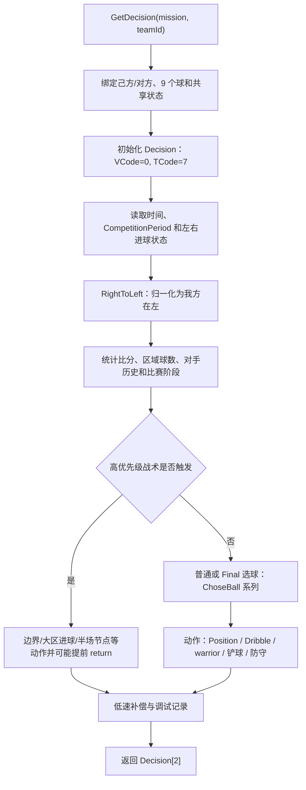

# 抢球博弈规则、坐标与接口说明

## 1. 适用范围与依据

本文适用于主线 `Strategy666/StrategyNew2V2`。发生冲突时按以下顺序判断：当前比赛正式规则、当前仿真平台实际加载的比赛实现与配置、主线策略代码、历史策略说明。历史文档中的阈值只能解释既有策略，不能覆盖正式规则或运行时事实。

主要依据：

- 根目录 `A07-智慧海洋赛道-水中机器人仿真组比赛规则及评审（裁判）说明.pdf`（2026 年 3 月版）第 3-7、11-13、20-23 页，SHA-256 `0CA7B2DAB7FBE56D12C831784524B83916C6F015E1AC695BB78986C44BA03BD2`。
- `比赛规则/A07-智慧海洋赛道-水中机器人仿真组比赛规则及评审（裁判）说明 (1).pdf` 第 3-4、9-10 页。
- `比赛规则/第十七届RST大赛-智慧海洋赛道-水中机器人仿真组比赛规则及评审(裁判)说明.pdf` 第 9-10 页。
- `比赛规则/URWPGSim2D开发人员手册.pdf` 第 15-19 页。
- `Sim2DSvr/MissionSvr.cs`、`Match/TheNewMatch2V2.cs`、`Common/config.xml`。
- 主线 `Strategy.cs`、`BaseAction.cs`、`GlobalVar.cs`。

## 2. 比赛项目与时间

服务端项目名“抢球博弈”实际映射到 `TheNewMatch2V2BallRace`。服务端比赛时间下拉框提供 10、5、3、1 分钟，默认选择 10 分钟；初始化时通过 `MissionCommonPara` 把所选分钟数写入比赛对象。`TheNewMatch2V2.cs` 中的 `5 * 60` 只用于常规时间平局后的制胜球阶段，不是正常比赛总时长。

正式抢球博弈为 10 分钟，上下半场各 5 分钟。默认周期是 100ms：

```text
总周期数 = 10 * 60 * 1000 / 100 = 6000
半场交换 = RemainingCycles == 3000
开赛后 7分30秒 = 4500 个 100ms 周期
```

`GlobalVar.Paishu` 在每次 `GetDecision` 调用时加一。它不是平台权威时钟；异步调用、暂停、策略重载或漏调都可能让它与 `RemainingCycles` 偏离。新增时间逻辑应优先由 `TotalSeconds`、`MsPerCycle` 和 `RemainingCycles` 推导，不能继续硬编码 5999、3000、4500。当前 `Strategy.cs` 的 `5999 - RemainingCycles` 还有首周期偏移风险。

## 3. 坐标、角度与场地

- 原点位于场地几何中心，单位为毫米。
- X 正方向向右，Z 正方向向下；Y 不参与 2D 策略。
- 从 X 正轴到 X 负轴，顺时针角为 0 至 `pi`，逆时针角为 0 至 `-pi`。
- 当前配置场地为 3000×2000mm：X 范围约 `[-1500, 1500]`，Z 范围约 `[-1000, 1000]`。
- 球门深度 150mm、宽度 400mm。
- 正式禁区尺寸为 400×1000mm：左禁区约为 `-1500 <= X <= -1100` 且 `|Z| <= 500`；右禁区对称。

`GlobalVar.Goal_line = -2100`、`Opp_Goal_line = 2100` 等常量与当前 3000×2000mm 配置不一致，不应作为新逻辑依据。

## 4. 官方区域与策略区域

`BaseAction.cs` 中名称带“禁区”的帮助函数多数是战术分区，不是正式比赛区域：

| 名称 | 当前判断 | 正确解释 |
| --- | --- | --- |
| `whether_in_myforbiddenareasmall` | `X < -952 && |Z| < 508` | 己方中央战术区，范围大于正式禁区。 |
| `whether_in_myforbiddenareabig` | `X < -952` | 己方纵向全宽战术区。 |
| `whether_in_myforbiddenarea_reduce` | 中央窄区或 `myhome` | 特定选球/回避用缩减区。 |
| `whether_in_oppforbiddenareabig` | `X > 952` | 对方纵向全宽战术区。 |
| `whether_in_oppforbiddenarea_reduce` | `X > 952 && |Z| < 507` | 对方中央战术区。 |

正式规则的抢球博弈章节没有单独规定“进入对方禁区即犯规”。历史说明中的“避免对方禁区以免犯规”不能视为当前正式规则；这类限制应标注为策略风险控制或战术约束。

## 5. 左右队与半场交换

服务端在半场交换时反转 `TeamsRef`，并把当前物理半场对应的 `teamId` 传入 `GetDecision`。`teamId` 不是固定队伍身份，不能跨半场缓存后继续当作身份使用。

主线先读取原始 `Mission`，随后调用 `RightToLeft()`：

- `teamId == 0`：不变，直接使用左侧视图。
- `teamId == 1`：将球、双方鱼的 `(X, Z)` 同时取反，相当于旋转 180 度；方向角加 `pi` 并归一化；左右进球状态交换。

因此 `RightToLeft()` 之后的主线战术都使用“我方在左”的归一化视图。新逻辑必须明确写在调用前还是调用后；默认应写在调用后。该方法不仅翻转 X，也翻转 Z，所以上下区域和角球编号的含义也会旋转。

## 6. 球编号与计分

| 球号 | 颜色 | 分值 | 初始位置概述 |
| --- | --- | ---: | --- |
| 0、1、2 | 蓝色 | 3 | 中线中央，从上到下。 |
| 3、4、5、6 | 紫色 | 1 | 四角，从左上顺时针。 |
| 7、8 | 红色 | 2 | 中线上下。 |

球进入左/右球门后，对应半场队伍获得分值。同一球重复进入同一队球门不重复计分，被顶出不扣分。常规时间比分相同时，进第一个球用时更短的队伍获胜；双方均未进球才判平局。因此测试记录不能只保留终场比分，同分局还必须保留胜负弹窗和首球时间证据。

平台向策略提供 `Ball_0_Left_Status` 至 `Ball_8_Left_Status` 和对应 Right 键。`Ball_1_Right_Status` 拼写正确且存在。比赛实现的初始化代码把 `Ball_0_Left_Status` 错误地赋成 `ballright[0]`，后续 `UpdateHtMissionVariables()` 才改为正确的 `ballleft[0]`；首次决策和重启路径必须通过运行测试确认。

## 7. 决策接口

- 策略类实现 `IStrategy`、继承 `MarshalByRefObject`。
- `InitializeLifetimeService()` 保持返回 `null`。
- `GetDecision(Mission mission, int teamId)` 每周期返回与鱼数相同且已初始化的 `Decision[]`。
- 项目团队合同要求 `0 <= VCode <= 14`、`0 <= TCode <= 14`，`TCode == 7` 表示直行。

旧版平台源码和服务端测试滑块实际允许 0-15，并会把大于 15 的值钳制为 15；这与开发手册及本项目合同冲突。为保持比赛兼容性，策略仍必须按 0-14 输出。当前主线含多处字面量 15，属于待修复的合同不一致。

## 8. 决策调用链



`Strategy.GetDecision` 中的提前返回会跳过后续战术，是全局优先级变化点。任何新增提前返回都必须做上下半场、左右侧和边界回归。

### 8.1 源码映射与评审要点

以下映射按主线 `Strategy.cs` 和 `BaseAction.cs` 当前源码静态复核，行号用于后续改动定位：

| 调用链层 | 主线位置 | 责任与出口 |
| --- | --- | --- |
| 输入绑定 | `Strategy.cs:49-82` | 创建/复用 `Decision[]`，绑定 `Mission`、`teamId`、我方/对方队伍和 9 个球；首周期调用 `GlobalVar.Init()`。 |
| 默认输出 | `Strategy.cs:84-103` | 每条鱼先写入 `VCode=0`、`TCode=7`，再采集鱼、球的位置快照。 |
| 状态更新 | `Strategy.cs:104-164` | 读取比赛阶段、剩余周期、18 个得分状态；2998/3000 周期备份/恢复比分；然后进入坐标归一化。 |
| 坐标归一化 | `Strategy.cs:165`、`1111-1168` | `RightToLeft()` 在 `teamId=1` 时旋转球、鱼、方向和左右得分，使后续战术统一面向左侧球门。 |
| 统计与阶段判断 | `Strategy.cs:167-290`、`571-625` | 统计己方/对方禁区球、比分、鱼速度和角速度，更新 `final`、`CQstage`、`lanqiuFlag` 等跨周期状态。 |
| 选球 | `Strategy.cs:275-310`、`358-365`、`418-440`、`857-895` | 通过 `ChoseBall_for_duqiumen`、`ChoseBall_OppHalf`、`ChoseBall20`、`choseball3_special`、`ChoseBallplus` 等分支确定两条鱼的目标球。 |
| 动作执行 | `Strategy.cs:315-345`、`487-559`、`671-706`、`843-930` | 调用 `BaseAction` 的 `the_warrior2`、`Dribblehometest1`、`Dribblehometestlast2min`、`chanqiuqubahaizi` 等动作；无目标时进入兜底动作。 |
| 输出与保护 | `Strategy.cs:349`、`722`、`818`、`1096-1107` | 记录基础诊断，所有直接出口调用 `ClampDecisionCodesForOutput()`，最终返回每条鱼已初始化且满足 0-14 合同的 `Decision[]`。 |

评审时必须逐一确认：每个提前 `return` 都经过输出保护；选球失败有无目标兜底；`teamId=1` 的归一化发生在所有战术判断之前；半场交换不会把跨周期目标和比分身份混用；`BaseAction` 只负责动作计算，不重新解释比赛规则。

## 9. 已确认的冲突与后续测试

1. `Paishu` 硬编码时间与平台权威时间可能漂移，应在后续改造为派生比赛阶段。
2. `Ball_0_Left_Status` 初始化取值错误，需要运行时首周期测试。
3. 主线存在 VCode/TCode 为 15 的赋值，与项目 0-14 合同冲突。
4. `GlobalVar` 中 ±2100/±1700 场地常量与当前 3000×2000mm 配置冲突。
5. `x<-952` 等“禁区”命名是战术区域，不得写成官方犯规边界。
6. `RightToLeft()` 同时翻转 X/Z；涉及上/下角、球号和方向的逻辑必须双侧验证。

## 10. 参赛产物与知识产权约束

- 线上评审的设计报告或策略文档必须为 PDF，且不超过 2000 字；对抗赛项目无需提交平台测试视频。
- 现场裁判通过客户端加载策略 DLL 并发出 `Ready` 指令；若参赛队无法到场，规则要求按通知的队伍 ID 文件夹和队名 DLL 提交。
- 提交作品必须原创且不得侵犯第三方专利、著作权、商标或其他合法权益。对手 DLL 只能作为黑盒对局基线；不得将反编译、重建或复制的对手实现作为候选或提交策略。
