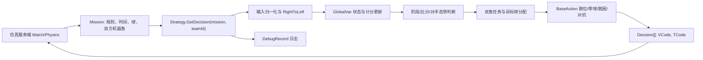
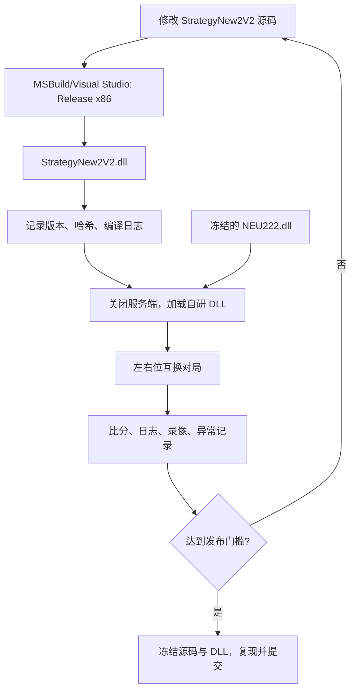

# 小黄鱼 2D 仿真项目架构概览

## 1. 系统定位

本项目是基于 URWPGSim2D 的 C# 2D 仿真机器鱼策略集合。仿真服务端负责比赛规则、物理环境、队伍状态与策略加载；每个策略以 DLL 形式实现 `IStrategy`，在每个仿真周期读取 `Mission`，返回各机器鱼的 `Decision[]`。

当前最成熟的项目是抢球博弈 `StrategyNew2V2`。水中搬运 `StrategyBallMoving`、生存挑战 `StrategyFightForLive`、花样游泳 `StrategySynchronisedSwimming` 基本为起步模板。

## 2. 目录与职责

| 位置 | 职责 | 使用原则 |
| --- | --- | --- |
| `.../URWPGSim2D/Strategy666` | 四个策略工程的当前主线候选 | 抢球博弈正式修改以此处为准 |
| `.../URWPGSim2D/Strategy666/StrategyNew2V2` | 抢球博弈源码与项目文件 | 当前核心开发区 |
| `新手试炼/BeginnerStrategy` | 抢球博弈隔离练习工程 | 教学和个人试验，验证后审查合入主线 |
| `新手试炼/SimServer` | 仿真运行文件、策略缓存、日志/录像 | 只运行和加载，不在 StrategyCache 中开发 |
| `.../URWPGSim2D/Common` | 场地、鱼、球、Mission、Decision 等共享模型 | 平台契约，修改会扩大影响面 |
| `.../URWPGSim2D/StrategyLoader` | `IStrategy` 与策略加载契约 | 策略 DLL 的接口边界 |
| `.../URWPGSim2D/Match` | 各比赛项目的规则、得分和重置逻辑 | 核对正式规则和状态键名 |
| `改代码`、`Backup`、`StrategyCache`、反编译目录 | 历史代码、试验产物、对手程序 | 只读参考，不作为主线真源 |
| `省赛` | 论文、策略说明、图表和最终作品 | 设计依据与历史经验，不代替当前代码 |

## 3. 工程与运行技术栈

- 语言：C#。
- 构建：旧式 MSBuild `.csproj`。
- 目标框架：.NET Framework 3.5。
- 目标平台：x86。
- 图形/数学依赖：Microsoft XNA Framework 3.1 对应 DLL。
- 平台接口：`URWPGSim2D.Common`、`URWPGSim2D.StrategyLoader`。
- 策略交付形式：类库 DLL。
- 运行平台：Windows 上的 URWPGSim2D 服务端。

## 4. 四个策略工程

| 工程 | 对应项目 | 当前代码状态 | 核心输出 |
| --- | --- | --- | --- |
| `StrategyNew2V2` | 2D 抢球博弈 | 已有完整宏观策略、选球、运球、禁区、堵门、边界与对抗逻辑 | 两条鱼的 `VCode/TCode` |
| `StrategyBallMoving` | 水中搬运 | 官方模板级 | 每周期各鱼决策 |
| `StrategyFightForLive` | 生存挑战 | 官方模板级 | 每周期各鱼决策 |
| `StrategySynchronisedSwimming` | 花样游泳 | 官方模板级，含前一周期决策变量 | 每周期各鱼决策 |

## 5. 抢球博弈内部模块

| 文件 | 主要职责 | 风险提示 |
| --- | --- | --- |
| `Strategy.cs` | `IStrategy` 实现、状态采集、左右转换、比赛阶段和战术优先级、最终动作调度 | 分支多，顺序改变会改变全局优先级 |
| `BaseAction.cs` | 选球、跑位、运球、进球、边界处理、堵门、绕行、挑球等底层动作 | 超过 1.2 万行，修改必须限定函数与场景 |
| `GlobalVar.cs` | Mission、双方队伍、球、计分、阶段、目标与跨周期状态 | 静态状态必须在新局初始化，避免串局 |
| `Compute.cs` | 距离、角度、坐标与运动学计算 | 角度范围和弧度/角度单位必须一致 |
| `DebugRecord.cs` | 调试信息收集和输出 | 高频输出可能影响性能；文本编码为历史兼容点 |
| `MyFishRobot.cs` | 机器鱼状态封装/辅助 | 与平台 `RoboFish` 数据保持一致 |
| `Point2D.cs` | 轻量二维点结构 | 坐标轴是 X/Z，不要误写成 X/Y |
| `Integration_Example.cs` | 对手阻挡绕行示例 | 不在 `.csproj` 编译清单中，示例存在不等于功能已集成 |

## 6. 每周期数据流

## 7. 接口与数据约束

### 7.1 策略接口

- `Strategy : MarshalByRefObject, IStrategy`。
- `InitializeLifetimeService()` 返回 `null`，保证远程策略对象不会因租约到期失效。
- `GetTeamName()` 返回平台展示的队伍名。
- `GetDecision(Mission mission, int teamId)` 在每个周期被调用，返回长度为 `FishCntPerTeam` 的决策数组。

### 7.2 决策输出

- `VCode` 取值 0-14，对应离散速度档位，档位与实际速度并非严格单调。
- `TCode` 取值 0-14；7 为直行，向两侧偏离 7 表示不同方向和强度的转弯。
- 任意档位切换需要若干周期达到稳态，不能把档位当作瞬时速度/角速度。

### 7.3 坐标和状态

- 场地中心为原点，单位为毫米，右为 X 正方向，下为 Z 正方向。
- 机器鱼常用数据包括 `PositionMm`、`PolygonVertices[0]`、`BodyDirectionRad`、`VelocityMmPs`、`AngularVelocityRadPs`。
- 球数据来自 `mission.EnvRef.Balls[0..8]`。
- 得分状态来自 `mission.HtMissionVariables` 中 `Ball_n_Left_Status` / `Ball_n_Right_Status`。
- 代码通过 `RightToLeft()` 把右队局面转换到统一视角；所有新战术应明确是在原始坐标还是统一坐标下运行。

## 8. 抢球宏观策略结构

现有代码的宏观路径大体为：

1. 采集双方鱼、9 个球、比赛周期与得分状态。
2. 处理半场交换与左右队坐标归一化。
3. 统计己方/对方区域球数、价值和比分态势。
4. 按高优先级分支处理末段禁区球、高价值禁区球、堵门等场景。
5. 在普通阶段或 Final 阶段分配两条鱼的目标球。
6. 调用角落、带球回家、单鱼进球、铲球、揽球、绕行或挑球动作。
7. 做低速补偿和输出保护，返回 `Decision[]`。

关键能力包括高分球优先、双鱼去冲突、角落/边界处理、半场交换、比分阶段策略、堵门识别、对手轨迹、阻挡绕行和僵持挑球。

## 9. 构建、加载与测试链路

## 10. 主要架构风险

- 多份近似源码：`Strategy`、`Strategy666`、`改代码`、`新手试炼` 容易造成改错目录或提交旧 DLL。
- DLL 缓存：服务端会在 StrategyCache 生成多个带时间戳副本，队名与哈希校验不可省略。
- 旧框架/位数：.NET Framework 3.5、XNA、x86 任何一个不匹配都可能导致编译成功但加载失败。
- 可执行文件占位：当前运行目录出现 `._cache_URWPGSim2DServer.exe`，必须确认真实程序已完整落盘。
- 巨型动作类：`BaseAction.cs` 修改影响面大，不能在一次改动中同时调整多组路径/阈值。
- 静态全局状态：新局初始化、半场交换和策略热切换都可能留下旧状态。
- 文档与代码漂移：区域边界、时间换算和优先级在历史文档中存在不一致，最终以正式规则和当前可执行代码的交叉验证为准。
- 未编译示例：`Integration_Example.cs` 未列入工程编译项，不能把它当作已交付功能。
- 对手过拟合：仅对 `NEU222.dll` 单侧、单局获胜不等于稳定优于对手。

## 11. 推荐的演进方向

- 保持平台接口与旧框架不变，先把策略内部逐步划分为状态快照、任务分配、行为选择和动作控制。
- 用命名常量统一球值、区域、时间、距离和速度阈值。
- 用小型纯计算函数承载评分、区域判断、目标有效性和阶段判断，便于人工构造输入测试。
- 将跨周期状态集中初始化，并为状态机定义明确入口、持续、退出和冷却条件。
- 用统计对局评价修改，至少同时观察胜率、净胜分、左右侧结果、卡死/脱困和异常率。

